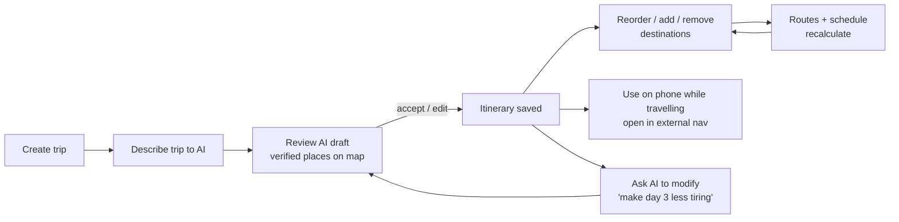

# ORBI — Product Requirements Document

> **Explore more. Plan smarter.**
> Status: Draft for approval · Last updated: 2026-11-08 · Owner: Niko

## 1. Summary

ORBI is an open-source, self-hostable, AI-assisted travel itinerary planner for web, Android and iOS. Its differentiator is a **map-centric itinerary**: every day of a trip is an ordered list of destinations that is shown as numbered markers connected by real road/walking geometry, with distances, travel times and a computed schedule that update when the user reorders anything.

AI (local, via Ollama) drafts and edits itineraries from natural language, but **the user always reviews AI output before it is saved**, and **coordinates always come from a geographic provider, never from the model**.

The MVP is a single-user, personal tool with **$0 recurring cost**.

## 2. Goals and non-goals

### Goals (MVP)

| #   | Goal                                                  | Measure of success                                                                                                |
| --- | ----------------------------------------------------- | ----------------------------------------------------------------------------------------------------------------- |
| G1  | Plan a multi-day trip end-to-end without leaving ORBI | A 3-day trip with ≥ 12 destinations can be created, scheduled and viewed on a map in < 15 min                     |
| G2  | Map-first itinerary                                   | Every scheduled destination is a numbered marker; each day has a distinctly coloured road/walk route              |
| G3  | Useful local AI                                       | A natural-language prompt produces a reviewable, schema-valid draft itinerary with verified locations             |
| G4  | $0 recurring cost                                     | Runs fully with no paid API keys; every external service is swappable for a self-hosted one                       |
| G5  | Cross-platform                                        | Same data on web and mobile; mobile usable while travelling                                                       |
| G6  | Open-source ready                                     | A developer can clone, configure and run ORBI locally from the README in < 30 min (excluding model/map downloads) |

### Non-goals (MVP)

- Multi-user accounts, sharing, collaboration, permissions.
- Turn-by-turn navigation (we deep-link to external navigation apps).
- Booking (hotels, flights, tickets) or payments.
- Real-time verified opening hours or prices (shown only as user/AI _estimates_ unless sourced and labelled).
- Full offline-first sync between devices (read-only offline cache on mobile only; see architecture §9).
- Public transit routing (OSRM does not support it; revisit with another provider later).

## 3. Users

**Primary persona — the owner (single user).** Plans personal and family trips, often in the Philippines (₱ budgets, island/city trips such as Cebu), uses a desktop to plan and a phone while travelling. Technically capable of running a home server and Ollama.

**Secondary persona (post-MVP) — the self-hosting developer.** Clones the repository, runs it with Docker Compose, possibly contributes.

## 4. Core user journey

## 5. Functional requirements

Priority: **P0** = MVP must-have, **P1** = MVP should-have, **P2** = post-MVP.

### 5.1 Trip management

| ID  | Requirement                                                                                                                                                             | Priority |
| --- | ----------------------------------------------------------------------------------------------------------------------------------------------------------------------- | -------- |
| T1  | Create, view, edit, delete a trip                                                                                                                                       | P0       |
| T2  | Trip fields: name, optional description, start location (place), destination region (place), start/end dates, timezone, currency, estimated budget, default travel mode | P0       |
| T3  | Travel preferences: pace (relaxed/moderate/packed), interests (tags), daily start/end time, max daily travel time, free-text notes                                      | P0       |
| T4  | Trip days are generated from the date range (one day per date); changing dates adds/removes trailing days with confirmation if they contain items                       | P0       |
| T5  | Trips without fixed dates (“Day 1…N”)                                                                                                                                   | P1       |
| T6  | Duplicate a trip                                                                                                                                                        | P2       |
| T7  | Export/import a trip as JSON (also serves as backup)                                                                                                                    | P1       |

### 5.2 Destination management

| ID  | Requirement                                                                                                                                                                                       | Priority |
| --- | ------------------------------------------------------------------------------------------------------------------------------------------------------------------------------------------------- | -------- |
| D1  | Search places by text (with optional bias to the trip region)                                                                                                                                     | P0       |
| D2  | Add a search result to the trip as a destination; coordinates and address come from the provider                                                                                                  | P0       |
| D3  | Destination fields: name, description, address, latitude, longitude, category, estimated visit duration, optional opening hours (free text, labelled with source), optional estimated cost, notes | P0       |
| D4  | Edit / remove a destination                                                                                                                                                                       | P0       |
| D5  | Unassigned destinations (“ideas” list) that can be assigned to a day later                                                                                                                        | P0       |
| D6  | Assign a destination to a day, move between days, reorder within a day                                                                                                                            | P0       |
| D7  | The same destination (e.g. the hotel) can appear on multiple days                                                                                                                                 | P1       |
| D8  | Drop a pin / pick a location on the map when search fails (coordinates from the map click, reverse-geocoded for the address)                                                                      | P1       |
| D9  | Discover places near a point by category (“food near our hotel”)                                                                                                                                  | P1       |

### 5.3 Interactive map

| ID  | Requirement                                                                                                                                            | Priority                    |
| --- | ------------------------------------------------------------------------------------------------------------------------------------------------------ | --------------------------- |
| M1  | Pan / zoom map; fits to the selected day (or whole trip)                                                                                               | P0                          |
| M2  | Numbered markers per day in itinerary order                                                                                                            | P0                          |
| M3  | Route line per day using real road/walking geometry from the routing provider                                                                          | P0                          |
| M4  | Distinct colour per day (accessible palette, also distinguishable by marker number/label, not by colour alone)                                         | P0                          |
| M5  | Per-leg and per-day distance and estimated duration                                                                                                    | P0                          |
| M6  | Selecting a marker highlights the itinerary card and vice versa                                                                                        | P0                          |
| M7  | Routes recalculate after reorder/add/remove/mode change                                                                                                | P0                          |
| M8  | Driving and walking modes (per day default + per-leg override)                                                                                         | P0 (per-day) / P1 (per-leg) |
| M9  | If routing is unavailable, show a **dashed** line clearly labelled “straight line — not a road route” with straight-line distance only and no duration | P0                          |
| M10 | “Open in maps” deep links (Google Maps / Apple Maps / geo: URI) per destination and per leg                                                            | P0                          |
| M11 | Visible map data attribution (OpenStreetMap and tile provider)                                                                                         | P0                          |

### 5.4 Daily itinerary and schedule

| ID  | Requirement                                                                                                                                                                  | Priority |
| --- | ---------------------------------------------------------------------------------------------------------------------------------------------------------------------------- | -------- |
| I1  | Each day shows its date, ordered destinations, computed arrival and departure times, travel time between stops, total travel time, total visit time and estimated daily cost | P0       |
| I2  | Schedule is computed (not stored) from: day start time, visit durations, leg durations, optional fixed start times                                                           | P0       |
| I3  | Warnings: day runs past configured end time, fixed time cannot be met, travel exceeds max daily travel time, cost over budget                                                | P1       |
| I4  | Drag-and-drop reorder on web (with keyboard alternative)                                                                                                                     | P0       |
| I5  | Long-press drag on mobile **plus** accessible “Move up / Move down / Move to day…” actions                                                                                   | P0       |
| I6  | Trip budget summary: estimated spend vs budget, per day and total                                                                                                            | P1       |
| I7  | “Optimize order” for a day — proposes a shorter order (shown as a reviewable proposal, not auto-applied)                                                                     | P1       |

### 5.5 AI itinerary generation

| ID  | Requirement                                                                                                                                                          | Priority |
| --- | -------------------------------------------------------------------------------------------------------------------------------------------------------------------- | -------- |
| A1  | User describes a trip in natural language; AI extracts structured preferences (region, days, budget, interests, pace) and shows them for confirmation/editing        | P0       |
| A2  | AI proposes destinations grouped by day with suggested order, visit durations and _estimated_ costs                                                                  | P0       |
| A3  | Every proposed destination is resolved via the geocoder; unresolved or out-of-region results are flagged “needs location” and cannot be saved until fixed or removed | P0       |
| A4  | Proposed day orders are checked/improved with the routing provider before display                                                                                    | P1       |
| A5  | The draft is shown on the map and timeline as a **proposal**; nothing is written to the itinerary until the user accepts (all, or per day)                           | P0       |
| A6  | AI-sourced fields (descriptions, durations, costs, hours) are labelled as AI estimates and are editable                                                              | P0       |
| A7  | Progress feedback during generation (stages: understanding → suggesting → locating → routing) and cancellation                                                       | P1       |
| A8  | Clear errors when Ollama is unreachable or the model returns invalid output (with retry)                                                                             | P0       |

### 5.6 AI itinerary editing

| ID  | Requirement                                                                                                                                     | Priority                         |
| --- | ----------------------------------------------------------------------------------------------------------------------------------------------- | -------------------------------- |
| E1  | Natural-language edit instructions on an existing trip (“move the beach to day 2”, “add a restaurant near our hotel”, “make day 3 less tiring”) | P0                               |
| E2  | AI returns a list of **edit operations** against existing item IDs (move, add, remove, reorder, update) rather than a regenerated itinerary     | P0                               |
| E3  | Operations are validated (IDs exist, days exist, new places geocoded) and shown as a diff preview                                               | P0                               |
| E4  | User applies all, applies selected operations, or discards                                                                                      | P0 (all/discard) / P1 (selected) |
| E5  | If the itinerary changed since the proposal was made, the proposal is marked stale and must be regenerated                                      | P0                               |
| E6  | Conversation history per trip                                                                                                                   | P1                               |

## 6. Non-functional requirements

| Area                 | Requirement                                                                                                                                                                                                                                                                                               |
| -------------------- | --------------------------------------------------------------------------------------------------------------------------------------------------------------------------------------------------------------------------------------------------------------------------------------------------------- |
| Cost                 | No mandatory paid services. All providers configurable; public free services used politely (rate-limited, cached, identifying User-Agent).                                                                                                                                                                |
| Privacy              | Data stays on the user's machine by default. AI runs locally. No telemetry.                                                                                                                                                                                                                               |
| Performance          | Itinerary interactions (reorder, select) respond in < 100 ms locally; route refresh for a cached day < 200 ms; uncached day route < 3 s with a public OSRM instance. AI generation is bounded by local hardware — target < 90 s for a 3-day trip on a mid-range GPU/Apple Silicon with an 8B-class model. |
| Reliability          | AI or routing failure never corrupts saved data; all multi-row changes are transactional.                                                                                                                                                                                                                 |
| Accessibility        | WCAG 2.2 AA for web; screen-reader labels and non-drag alternatives on mobile; colour is never the only signal.                                                                                                                                                                                           |
| Responsiveness       | Web works from 360 px wide (stacked layout) to wide desktop (split view).                                                                                                                                                                                                                                 |
| Portability          | Runs on Windows, macOS and Linux for development; server runs on any machine with Node.js (Docker optional).                                                                                                                                                                                              |
| Security             | Single-user, but the API requires a bearer token whenever it listens on a non-loopback interface. No secrets in the repository.                                                                                                                                                                           |
| Internationalisation | MVP is English UI; data model stores currency (ISO 4217) and timezone (IANA) per trip.                                                                                                                                                                                                                    |

## 7. UX direction

- **Web:** split screen. Left panel (≈ 420–480 px, resizable): trip header, day selector, timeline of destination cards, unassigned ideas, AI assistant drawer. Right: full-height map with route summary overlay. Below 1024 px the map and itinerary become tabs; below 640 px a bottom-sheet pattern mirrors mobile.
- **Mobile:** full-screen map with a three-snap bottom sheet (peek: day selector + day summary; half: timeline; full: details/AI). Native share/“open in maps” actions.
- **Design system:** neutral greys, one accent colour, a fixed 8-colour day palette tested for colour-blind distinguishability, Inter-class sans typography, 4 px spacing grid. Tokens are shared; components are platform-native (shadcn/ui on web, native components on mobile).
- **States:** every list and map view defines loading, empty (with a primary action), error (with retry) and partial (e.g. “2 legs could not be routed”) states.

## 8. Success criteria for the MVP release

1. The owner plans a real trip with ORBI and uses it on their phone during the trip.
2. A fresh clone runs locally on Windows and macOS following only the README.
3. With Ollama stopped, every non-AI feature still works.
4. With public routing unreachable, the map degrades to labelled straight lines; nothing crashes.
5. No paid credential is required anywhere.

## 9. Risks (product level)

| Risk                                                           | Impact                       | Mitigation                                                                                                              |
| -------------------------------------------------------------- | ---------------------------- | ----------------------------------------------------------------------------------------------------------------------- |
| Small local models produce poor or invalid itineraries         | AI feature feels unreliable  | Pipeline design with Zod validation + one repair retry; geocoding verification; user review step; model is configurable |
| Public OSM services throttle or block                          | Search/routing stops working | Caching, client-side debounce, 1 req/s queue, documented self-hosting (Docker)                                          |
| iOS distribution needs a Mac or a paid Apple Developer account | iOS app unusable on device   | Android-first for native; the responsive web app (PWA-capable) covers iPhone until resolved — **decision needed**       |
| Phone cannot reach the home server while travelling            | Mobile useless on the road   | Private overlay network (Tailscale/Headscale) or tunnel; read-only offline cache on mobile                              |

## 10. Open product questions

1. Which machine will run Ollama and the server (RAM/GPU)? This determines the default model.
2. Is iOS on a physical device required for the MVP, and is a Mac available?
3. Default currency/region: assume PHP / Asia/Manila for seed data and examples?
