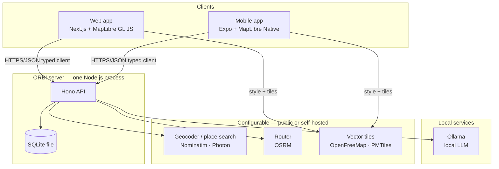
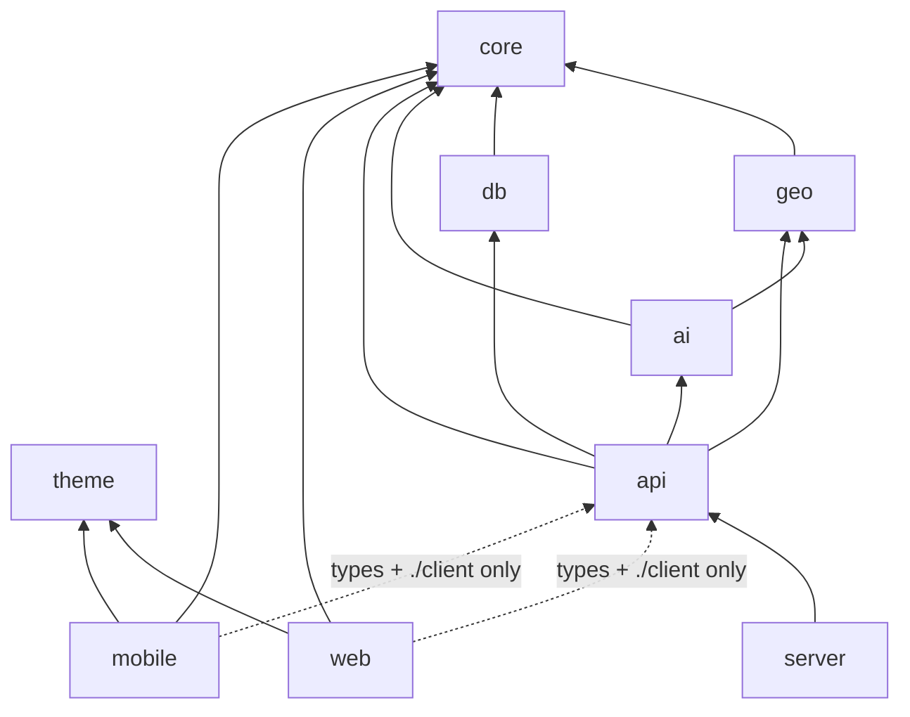
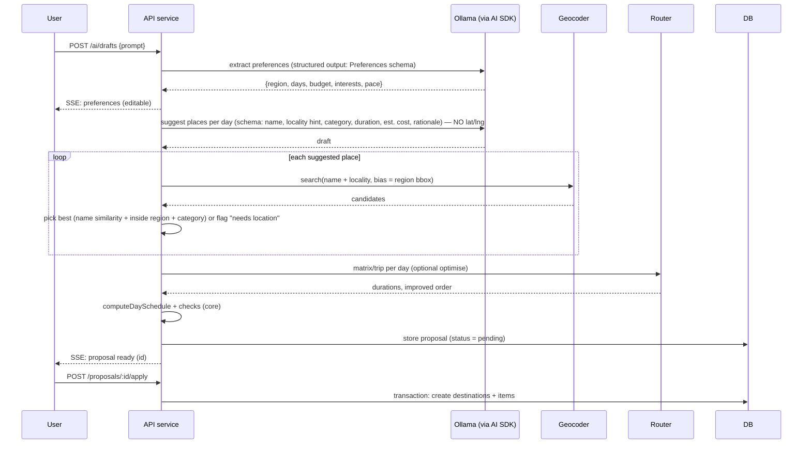
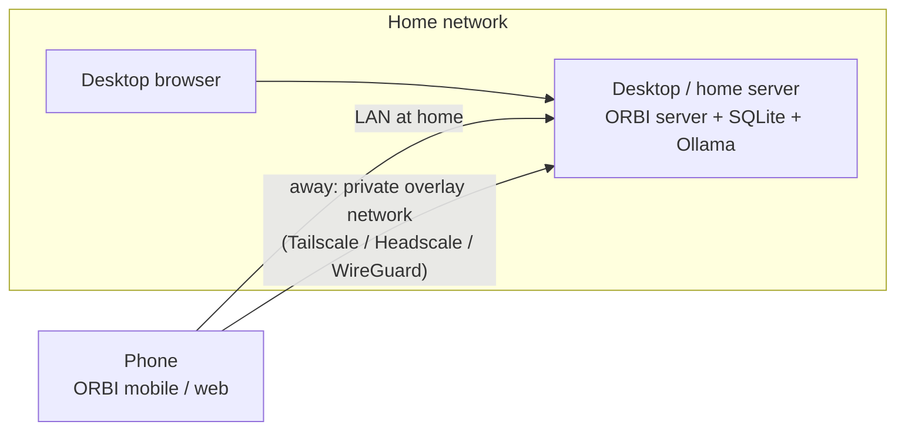

# ORBI — Architecture

> Status: Draft for approval · Last updated: 2026-11-08
> Companion docs: [PRD](./PRD.md) · [Database](./database.md) · [Technical decisions](./technical-decisions.md) · [Roadmap](./roadmap.md)

## 1. Architectural principles

1. **Thin clients, one backend.** Web and mobile are UI shells over a single typed HTTP API. All business rules that change data live in shared packages executed by the server; pure calculations (schedule, totals, geo math) are shared so clients can render instantly.
2. **Providers behind interfaces.** Geocoding, place search, routing, route optimisation, map tiles and AI inference are each an interface with a configurable implementation. Nothing outside the provider package knows a vendor URL.
3. **Authoritative data vs. derived data.** Itinerary order, destinations and their coordinates are authoritative and stored. Routes, schedules and totals are _derived_; routes are cached, schedules/totals are computed on read.
4. **AI proposes, the user disposes.** AI output is a validated _proposal_ stored separately from the itinerary. Only an explicit user action applies it.
5. **Local first, cloud optional.** Everything runs on one machine with no account anywhere. Remote access and sync are additive.
6. **No speculative abstraction.** One database dialect, one AI provider and one provider per geo concern ship in the MVP. Interfaces exist where a second implementation is already planned (geo providers, AI providers) — nowhere else.

## 2. System context



Notes:

- **Clients never call geocoding/routing providers directly.** The server enforces rate limits, sets the required identifying `User-Agent`, and caches results. This keeps public-service usage within policy and makes provider swaps a server-only config change.
- **Clients do fetch map tiles directly** (tile traffic is high-volume and cache-friendly in the map SDKs). The tile _style URL_ is obtained from the server's `/config` endpoint, so switching tile providers does not require rebuilding the mobile app.

## 3. Monorepo structure (final proposal)

```text
orbi/
├── apps/
│   ├── web/                 Next.js App Router · Tailwind v4 · shadcn/ui · react-map-gl (MapLibre)
│   ├── mobile/              Expo (dev builds) · Expo Router · @maplibre/maplibre-react-native · bottom sheet
│   └── server/              Thin Node entry: loads env, runs migrations, serves @orbi/api via @hono/node-server
│
├── packages/
│   ├── core/                Pure TS, zero I/O. Zod schemas (+ inferred types), API DTOs,
│   │                        schedule/budget/itinerary calculations, edit-operation semantics, constants
│   ├── geo/                 Provider interfaces (Geocoder, PlaceSearch, Router, RouteOptimizer),
│   │                        Nominatim / Photon / OSRM implementations, rate limiter, geo utilities,
│   │                        polyline codec, external-navigation link builders
│   ├── db/                  Drizzle schema, migrations, client factory, repositories, test helpers
│   ├── ai/                  AI provider registry (Ollama default), prompts, generation & edit pipelines,
│   │                        tool definitions, output validation/repair
│   ├── api/                 Hono app factory, routes, middleware, services; exports `AppType`
│   │                        and a `./client` entry (typed `hc` client) for the apps
│   ├── theme/               Design tokens: Tailwind v4 `@theme` CSS + TS token export (day palette, spacing)
│   ├── typescript-config/   (existing) shared tsconfig presets
│   └── eslint-config/       (existing) shared ESLint flat configs
│
├── infra/
│   ├── docker-compose.yml   server + optional ollama / osrm / photon / tiles profiles
│   └── scripts/             fetch OSM extract, build OSRM data, build PMTiles
│
├── docs/                    PRD, architecture, database, roadmap, technical decisions, self-hosting
├── turbo.json · pnpm-workspace.yaml · package.json · README.md · LICENSE · …
```

### Changes from the reference structure, and why

| Change                                                 | Reason                                                                                                                                                                                                                                              |
| ------------------------------------------------------ | --------------------------------------------------------------------------------------------------------------------------------------------------------------------------------------------------------------------------------------------------- |
| `shared` + `validators` → **`core`**                   | Types are derived from Zod schemas (`z.infer`). Keeping schemas and types in separate packages duplicates the source of truth. One pure package holds schemas, types and business calculations.                                                     |
| `maps` → **`geo`**                                     | The package contains geocoding/routing/geo math — _not_ map rendering, which stays in each app. The name prevents rendering code from creeping in.                                                                                                  |
| `database` → **`db`**                                  | Shorter import (`@orbi/db`); no semantic change.                                                                                                                                                                                                    |
| Added **`apps/server`**                                | Turborepo apps should not be imported by other workspaces. The Hono app (and its `AppType`) lives in `packages/api` so both clients can import its _types_; `apps/server` is the deployable process (env, port, static assets, migrations, Docker). |
| Added **`packages/theme`**                             | Both apps consume the same tokens (and the map layers need the day palette as hex values on both platforms).                                                                                                                                        |
| Removed scaffold **`apps/docs`** and **`packages/ui`** | `apps/docs` is a create-turbo demo. Cross-platform UI components are explicitly _not_ shared; shadcn components live inside `apps/web` per shadcn's monorepo-free default.                                                                          |
| Removed **`.turbo-clone-temp/`**                       | Accidentally committed gitlink (a full clone of the Turborepo source repo, mode 160000, no `.gitmodules`). Not part of ORBI.                                                                                                                        |
| Package scope `@repo/*` → **`@orbi/*`**                | Project-specific scope for clarity and future publishing.                                                                                                                                                                                           |

### Dependency rules



- `core` and `theme` depend on nothing internal. `core`'s only runtime dependency is `zod`.
- **Apps never import `db`, `ai` or provider implementations from `geo`.** They may import `@orbi/geo/utils` (pure math, polyline decoding, nav links). Enforced with package `exports` (server-only entry points are separate subpaths) and by `turbo boundaries`, which rejects importing any package that is not a declared dependency (the apps never declare `@orbi/db` or `@orbi/ai`). Boundaries _tags_ were not used: their rules apply transitively, so `web → api → db` would always violate a "web must not depend on db" rule.
- `@orbi/api/client` imports `hono/client` and `import type { AppType }` only — no server code is bundled into the apps.

### Internal package compilation

All internal packages are **Just-in-Time packages** (export `.ts` source; no build step), as recommended by Turborepo for apps with modern bundlers:

- `apps/web`: Next.js compiles workspace TS (`transpilePackages` if needed).
- `apps/mobile`: Metro compiles workspace TS (Expo's monorepo support; verified in Phase 1).
- `apps/server`: runs TS directly with Node 26's built-in type stripping, in dev (`node --watch`) and production (verified in Phase 1). Consequence for all packages: relative imports use explicit `.ts` extensions and only erasable TypeScript syntax is allowed (`erasableSyntaxOnly`), so no `enum`, `namespace` or parameter properties.

Trade-off accepted: Turborepo cannot cache per-package builds; at ORBI's size this is negligible.

## 4. Package responsibilities in detail

### 4.1 `@orbi/core` (pure, isomorphic)

- **Schemas** (`schemas/`): `Trip`, `TripPreferences`, `TripDay`, `Destination`, `ItineraryItem`, `TravelMode`, `Money`, `LatLng`, request/response DTOs, `ItineraryEditOperation` (discriminated union), `AiItineraryDraft`.
- **Calculations** (`itinerary/`):
  - `computeDaySchedule(day, items, legs, prefs) → { stops: [{arrival, departure}], warnings }`
  - `summarizeDay(...)` / `summarizeTrip(...)` → travel time, visit time, cost vs budget
  - `applyEditOperations(itinerary, ops) → { itinerary, errors }` — pure; used by the server to validate and preview AI edits, and by clients to render the diff.
  - `reorder(items, from, to)` helpers that produce the exact payload the API expects.
- **Constants**: travel modes, categories, pace presets, limits (max items per day, etc.).
- No React, no Node APIs, no `fetch`.

### 4.2 `@orbi/geo`

```ts
// Shapes only — illustrative, not final code.
interface Geocoder {
  search(
    q: string,
    opts?: { near?: LatLng; bbox?: BBox; limit?: number; lang?: string },
  ): Promise<PlaceCandidate[]>;
  reverse(at: LatLng): Promise<PlaceCandidate | null>;
}
interface PlaceSearch {
  // category/nearby discovery ("food near hotel")
  nearby(
    at: LatLng,
    opts: { category: PlaceCategory; radiusM: number; limit?: number },
  ): Promise<PlaceCandidate[]>;
}
interface Router {
  readonly modes: readonly TravelMode[]; // capabilities, e.g. ['driving','walking']
  route(waypoints: LatLng[], mode: TravelMode): Promise<RouteResult>; // legs[] with distanceM, durationS, geometry
  matrix?(points: LatLng[], mode: TravelMode): Promise<DurationMatrix>;
}
interface RouteOptimizer {
  optimize(
    points: LatLng[],
    mode: TravelMode,
    opts: { fixStart?: boolean; fixEnd?: boolean },
  ): Promise<number[]>; // new order
}
```

- **Implementations (MVP):** `NominatimGeocoder`, `PhotonGeocoder` (type-ahead friendly), `OverpassPlaceSearch` _(P1, see technical decisions)_, `OsrmRouter` (route + table + trip), `OsrmTripOptimizer`, and `LocalOptimizer` (nearest-neighbour + 2-opt over a duration matrix; fallback when the provider has no trip service).
- **Cross-cutting:** a per-provider token-bucket rate limiter (default 1 req/s for public instances), request timeout + retry with backoff on 429/5xx, mandatory configurable `User-Agent`/`Referer`.
- **Utils (client-safe, `@orbi/geo/utils`):** haversine distance, bounding box/fit helpers, polyline6 encode/decode, coordinate rounding for cache keys, `buildNavigationLinks(dest, mode)` → Google Maps / Apple Maps / `geo:` URIs.
- **Factory:** `createGeoProviders(config)` reads `GEOCODER_PROVIDER`, `ROUTER_PROVIDER`, base URLs, and returns the instances. Caching is _not_ inside providers — it is a decorator owned by the API layer backed by `@orbi/db` cache tables, so providers stay stateless and testable.

### 4.3 `@orbi/db`

- Drizzle schema for SQLite, generated SQL migrations committed to the repo, `createDb(path)` factory that enables `PRAGMA foreign_keys = ON`, `journal_mode = WAL`, `busy_timeout`.
- **Repositories** (plain functions taking a `db`/`tx` handle): `trips`, `days`, `destinations`, `items`, `routeCache`, `geocodeCache`, `ai`. Services depend on repository functions, not on Drizzle query builders directly — this is the seam for a future PostgreSQL implementation (see [database.md §8](./database.md#8-postgresql-migration-path)).
- `createTestDb()` — in-memory SQLite with migrations applied, for integration tests.

### 4.4 `@orbi/ai`

See [§6 AI architecture](#6-ai-architecture).

### 4.5 `@orbi/api`

- `createApp(deps)` builds the Hono app from injected dependencies (`db`, `geo`, `ai`, `config`) — no globals, so tests construct it with fakes.
- Layers: **routes** (HTTP, Zod validation via `@hono/zod-validator` with schemas from `core`) → **services** (use cases, transactions, provider orchestration) → **repositories** (`db`).
- Middleware: request ID, structured logging, error → RFC 9457 `application/problem+json`, CORS (allow-list), bearer-token auth (enabled when bound to a non-loopback address or `ORBI_API_TOKEN` set), body size limit.
- Exports `type AppType` and `./client` (`createOrbiClient(baseUrl, token)`).

### 4.6 `apps/server`

- Reads and validates env with a Zod schema (fail fast with readable errors).
- Runs pending migrations on start (with a `--no-migrate` flag), then serves the API.
- Optional: serves a local PMTiles file and style JSON under `/tiles` for fully self-hosted maps (HTTP range requests).
- Health endpoint reports reachability of Ollama, geocoder and router.

### 4.7 `apps/web`

- Next.js App Router. Mostly client components for the planner (map + drag-and-drop are interactive); server components for shells and trip list where useful.
- Calls the API through `@orbi/api/client` + **TanStack Query** (server-state cache, optimistic reorder, invalidation). No global state library; local UI state stays in React.
- In dev and self-hosted deployments, `next.config` **rewrites `/api/*` to the ORBI server**, so the browser talks same-origin (no CORS, token kept server-side via a Next route handler proxy when exposed beyond localhost).
- Map: `react-map-gl/maplibre` over `maplibre-gl` — declarative `<Source>`/`<Layer>` that mirror the mobile SDK's model, so map logic (GeoJSON builders in `core`/`geo/utils`) is shared even though components are not.
- Drag and drop: `@dnd-kit` with keyboard sensor.

### 4.8 `apps/mobile`

- Expo (current SDK at Phase 1 — SDK 58 as of this writing), **development builds** (MapLibre Native is not in Expo Go), Expo Router.
- `@maplibre/maplibre-react-native` v11 (New Architecture only — fine, Expo defaults to it).
- Bottom sheet (`@gorhom/bottom-sheet`), reorderable list with long-press + explicit move actions.
- Same `@orbi/api/client` + TanStack Query; query cache persisted to device storage for read-only offline viewing.
- Server URL and token are configured **in-app** (Settings screen, stored in `expo-secure-store`) with `EXPO_PUBLIC_API_URL` as the default — LAN IPs change, so build-time-only config would be fragile.

## 5. API boundaries

REST over JSON, resources nested where ownership is strict. All bodies validated with `core` schemas; all responses typed via `AppType`.

| Method & path                                                                | Purpose                                                                                          |
| ---------------------------------------------------------------------------- | ------------------------------------------------------------------------------------------------ |
| `GET /health`                                                                | Liveness + dependency status (db, ollama, geocoder, router)                                      |
| `GET /config`                                                                | Client config: tile style URL, attribution, supported travel modes, AI availability              |
| `GET /trips` · `POST /trips`                                                 | List / create                                                                                    |
| `GET /trips/:tripId`                                                         | **Aggregate**: trip + preferences + days + items + destinations (one round trip for the planner) |
| `PATCH /trips/:tripId` · `DELETE /trips/:tripId`                             | Update (dates change regenerates days) / delete (cascade)                                        |
| `PUT /trips/:tripId/preferences`                                             | Replace preferences                                                                              |
| `POST /trips/:tripId/destinations`                                           | Add destination (from a geocoder candidate or a map pin)                                         |
| `PATCH /destinations/:id` · `DELETE /destinations/:id`                       | Edit / remove                                                                                    |
| `PATCH /days/:dayId`                                                         | Day title, notes, start time, travel mode                                                        |
| `POST /days/:dayId/items`                                                    | Schedule a destination on a day at a position                                                    |
| `PATCH /items/:id` · `DELETE /items/:id`                                     | Fixed time, duration override, notes / unschedule                                                |
| `PUT /days/:dayId/order`                                                     | Body: full ordered `itemIds[]` — idempotent reorder                                              |
| `POST /items/:id/move`                                                       | Move to another day/position                                                                     |
| `GET /days/:dayId/route`                                                     | Derived route for the day (cached; `?refresh=1` bypasses cache)                                  |
| `POST /days/:dayId/optimize`                                                 | Returns a proposed order + time saved (does not apply)                                           |
| `GET /places/search` · `GET /places/reverse` · `GET /places/nearby`          | Geocoding / discovery, server-side cached + rate limited                                         |
| `POST /ai/drafts`                                                            | Generate itinerary draft → proposal (streams progress events via SSE)                            |
| `POST /trips/:tripId/ai/edits`                                               | Natural-language edit → proposal                                                                 |
| `GET /proposals/:id` · `POST /proposals/:id/apply` · `DELETE /proposals/:id` | Review / apply (optionally a subset of operations) / discard                                     |
| `GET /trips/:tripId/export` · `POST /trips/import`                           | JSON backup/restore                                                                              |

Conventions: IDs are opaque strings; times are `HH:MM` in the trip's timezone; dates are `YYYY-MM-DD`; money is integer minor units + trip currency; optimistic concurrency via `trips.revision` (`If-Match`-style `expectedRevision` on mutating requests, `409` on conflict).

## 6. AI architecture

### 6.1 Layout of `@orbi/ai`

```text
packages/ai/src/
├── providers/      registry: createModel(config) → AI SDK LanguageModel (ollama default; others later)
├── prompts/        versioned prompt templates (pure functions of typed inputs)
├── tools/          AI SDK tool definitions wrapping @orbi/geo (search_places, nearby_places, route_matrix)
├── pipelines/
│   ├── extract-preferences.ts
│   ├── generate-itinerary.ts
│   └── edit-itinerary.ts
└── validation/     Zod output schemas (from core), repair-retry, semantic checks
```

Provider configuration (`AI_PROVIDER=ollama`, `OLLAMA_BASE_URL`, `AI_MODEL`, `AI_TEMPERATURE`, timeouts) is read by the server and passed in; the package has no env access.

### 6.2 Generation pipeline

The model never emits coordinates. Location truth comes from the geocoder.



- **Structured output:** AI SDK `generateObject`/structured output with the Zod schema; Ollama's JSON-schema `format` constrains decoding. On Zod failure: **one repair retry** sending the validation errors back; then fail with a clear error.
- **Tool calling is an enhancement, not a dependency.** Many small local models call tools unreliably. The pipeline above is deterministic orchestration (model → server geocodes). When the configured model supports tools well, the edit pipeline may let the model call `search_places`/`nearby_places` (e.g. “restaurant near our hotel”), still followed by server-side verification.
- **Semantic validation** after schema validation: day count matches, no duplicate places, durations within sane bounds, every place resolved or flagged, budget estimate labelled as estimate.

### 6.3 Edit pipeline

1. Server sends the model a **compact itinerary snapshot** (item IDs, names, day numbers, order, durations, coordinates rounded, preferences) and the user's instruction.
2. Model returns `ItineraryEditOperation[]`:
   `move_item{itemId, toDayId, toPosition}` · `remove_item{itemId}` · `add_place{dayId, position, query, localityHint, category, durationMin}` · `reorder_day{dayId, itemIds[]}` · `update_item{itemId, durationMin?, notes?, fixedStart?}` · `replace_place{itemId, query, …}`.
3. Server geocodes any `add_place`/`replace_place`, runs `applyEditOperations` (pure, from `core`) against the current state to detect invalid IDs/conflicts, recomputes routes/schedule for touched days, and stores a proposal with `baseRevision`.
4. Client shows a diff (added / removed / moved) on timeline and map; user applies all or a subset. Apply fails with `409` if `trips.revision` moved on.

### 6.4 Model guidance

Default recommendation: an 8B–14B instruction model with good JSON/tool support that fits the owner's hardware (finalised in Phase 5 with a small eval set of ~10 prompts scored for schema validity, geocode hit rate and day balance). Model licence is recorded in docs, since model licences differ (Apache-2.0, Llama Community Licence, Gemma terms, …).

## 7. Map architecture

| Concern               | Web                                       | Mobile                            | Shared                                                          |
| --------------------- | ----------------------------------------- | --------------------------------- | --------------------------------------------------------------- |
| Rendering             | `maplibre-gl` via `react-map-gl/maplibre` | `@maplibre/maplibre-react-native` | —                                                               |
| Style / tiles         | Style URL from `/config`                  | Style URL from `/config`          | Provider config on server                                       |
| Markers & routes data | GeoJSON sources + symbol/line layers      | Same GeoJSON + native layers      | `buildDayFeatures(items, route, palette)` in `core`/`geo/utils` |
| Geocoding / search    | via API                                   | via API                           | `@orbi/geo` on server                                           |
| Routing               | via API                                   | via API                           | `@orbi/geo` on server                                           |
| Optimisation          | via API                                   | via API                           | `@orbi/geo` on server                                           |
| Geo math              | —                                         | —                                 | `@orbi/geo/utils`                                               |

- Numbered markers are rendered as **map layers** (circle + symbol with the item number) rather than DOM/React views, for performance and identical look on both platforms. Selection uses feature-state/ID filters.
- Route lines: one `LineString` per leg (so a single failed leg can be drawn dashed while others are solid), coloured by day.
- Straight-line fallback is a distinct layer style (dashed, reduced opacity) with a legend entry.

## 8. Route calculation and caching (summary)

- A day's route = ordered waypoints of its items + travel mode. It is **derived**.
- Cache is **content-addressed per leg**: key = `(provider, profile, roundedFrom, roundedTo)`. Reordering only creates new legs; unchanged legs hit cache.
- On a cache miss for any leg, the server requests the **whole day in one OSRM `route` call** (1 request regardless of stop count — important at 1 req/s), splits the response into legs and stores all of them.
- TTL (default 30 days) handles road-network changes; `?refresh=1` forces recomputation. Details in [database.md §6](./database.md#6-derived-data-and-caching).

## 9. Local-first operation and remote access

### 9.1 Deployment topology (MVP)



### 9.2 Away from the local network

Options, in recommended order:

| Option                                                                   | Cost class                                            | Notes                                                                                               |
| ------------------------------------------------------------------------ | ----------------------------------------------------- | --------------------------------------------------------------------------------------------------- |
| **Tailscale** (WireGuard mesh)                                           | Free hosted service with limits (personal plan)       | No ports opened; server never exposed publicly; works on iOS/Android/desktop. Recommended default.  |
| **Headscale** (self-hosted Tailscale control server) + Tailscale clients | Self-hosted, needs an always-on host with a public IP | Fully open-source path.                                                                             |
| **Plain WireGuard** on router/VPS                                        | Self-hosted                                           | Most manual.                                                                                        |
| **Cloudflare Tunnel**                                                    | Free hosted service with limits                       | Exposes a public URL — then the bearer token _and_ HTTPS are mandatory. Not recommended as default. |

The home machine must be on for AI and edits. For travel, two mitigations:

1. **Read-only offline cache (MVP, P1):** mobile persists the last-fetched trip aggregate and day routes; the itinerary and route lines are viewable without connectivity (map tiles may be missing unless pre-cached — MapLibre Native offline packs are a post-MVP item).
2. **Future sync (post-MVP):** see §10.

## 10. Prepared-for, not built: sync and multi-user

Decisions taken now so these remain possible without rewrites:

- **Client-generatable IDs** (UUIDv7) — offline-created records don't collide.
- **`created_at` / `updated_at` / `revision`** on mutable rows — basis for change feeds and conflict detection.
- **Soft boundary on `trip_id`** — every row is reachable from a trip, the natural unit of sharing/sync.
- **No user table yet.** Multi-user later adds `users`, `trip_members` and an `owner_id` column, plus real auth (e.g. OIDC via a self-hostable IdP) — the bearer-token middleware is the single place auth plugs in.
- **Sync options to evaluate later:** a server-authoritative change log (`/changes?since=`) with last-writer-wins per field; or adopting a sync engine (e.g. PowerSync/ElectricSQL-class, or CRDTs for collaborative editing). Not chosen now.

## 11. Configuration

All configuration via environment variables validated at server start; `.env.example` documents every key. Strict env mode in Turborepo (declare server env in `turbo.json`; `NEXT_PUBLIC_*` and `EXPO_PUBLIC_*` are inferred automatically).

| Variable                                                                  | Default                                           | Purpose                                 |
| ------------------------------------------------------------------------- | ------------------------------------------------- | --------------------------------------- |
| `ORBI_HOST` / `ORBI_PORT`                                                 | `127.0.0.1` / `3100`                              | Bind address                            |
| `ORBI_API_TOKEN`                                                          | _(unset)_                                         | Required when host is not loopback      |
| `ORBI_DATABASE_PATH`                                                      | `./data/orbi.db`                                  | SQLite file (git-ignored)               |
| `ORBI_CORS_ORIGINS`                                                       | `http://localhost:3000`                           | Allow-list                              |
| `AI_PROVIDER` / `AI_MODEL` / `OLLAMA_BASE_URL`                            | `ollama` / _(Phase 5)_ / `http://127.0.0.1:11434` | AI                                      |
| `GEOCODER_PROVIDER` / `GEOCODER_BASE_URL`                                 | `nominatim` / public instance                     | Geocoding                               |
| `GEO_USER_AGENT` / `GEO_CONTACT_EMAIL`                                    | _(required)_                                      | Required by OSM service policies        |
| `ROUTER_PROVIDER` / `ROUTER_BASE_URL_DRIVING` / `ROUTER_BASE_URL_WALKING` | `osrm` / FOSSGIS demo endpoints                   | Routing per profile                     |
| `MAP_STYLE_URL` / `MAP_ATTRIBUTION`                                       | OpenFreeMap style                                 | Tiles (served to clients via `/config`) |
| `NEXT_PUBLIC_…` / `EXPO_PUBLIC_API_URL`                                   | —                                                 | Client defaults only — never secrets    |

## 12. Error handling, observability, testing

- **Errors:** typed domain errors in services (`NotFound`, `Conflict`, `ProviderUnavailable`, `AiOutputInvalid`, `RateLimited`) mapped to problem+json; clients map them to inline states (retry buttons, “routing unavailable” banners).
- **Logging:** structured JSON logs with request IDs; AI prompts/responses logged only at `debug` level (they may contain personal trip details).
- **Testing pyramid:**
  - Unit (Vitest): `core` calculations, edit operations, `geo` utils, providers against recorded HTTP fixtures, AI pipelines with the AI SDK mock model.
  - Integration (Vitest): `createApp` + in-memory SQLite via `app.request()` — every route, including transactions and cascade deletes.
  - E2E (Phase 6): Playwright on web against a seeded server with stubbed geo/AI providers.
  - Mobile: `jest-expo` for critical components; manual device checklist for map/gesture behaviour.
