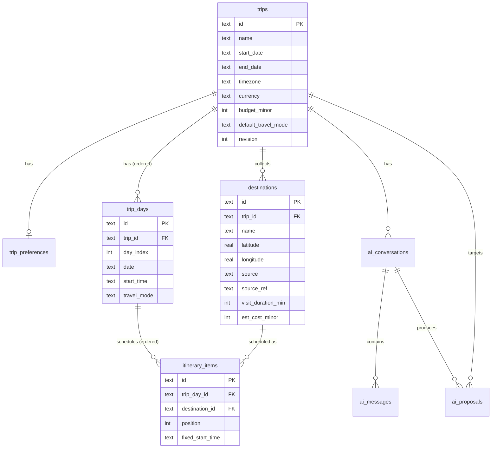

# ORBI — Database Design

> Status: Draft for approval · Last updated: 2026-11-08
> Engine: SQLite (single file) · ORM: Drizzle ORM + Drizzle Kit · Package: `@orbi/db`

## 1. Design goals

1. **Authoritative vs derived.** Stored: trips, preferences, days, destinations (with verified coordinates), ordered itinerary items, AI conversations/proposals. Derived and **not** authoritative: routes (cached), schedules and totals (computed on read).
2. **Normalised, but not over-normalised.** One row per real concept; JSON columns only for genuinely list-shaped, never-queried data (interest tags, AI payloads), always validated with Zod on read and write.
3. **Portable to PostgreSQL.** Avoid SQLite-only features in queries (no `rowid` reliance, no JSON1 functions in business queries, no `WITHOUT ROWID` tricks). Types chosen to map 1:1 to Postgres.
4. **Sync-ready.** Client-generatable IDs, timestamps on every mutable row, a `revision` counter on trips.
5. **No users/auth tables** in the MVP (single user).

## 2. Conventions

| Concern        | Convention                                                                                                                        | Postgres mapping later                      |
| -------------- | --------------------------------------------------------------------------------------------------------------------------------- | ------------------------------------------- |
| Primary keys   | `id TEXT` UUIDv7 generated in the app (time-ordered → index-friendly; creatable offline)                                          | `uuid`                                      |
| Timestamps     | `created_at`, `updated_at` as `INTEGER` Unix epoch **milliseconds** (Drizzle `integer({ mode: 'timestamp_ms' })`), set by the app | `timestamptz`                               |
| Calendar dates | `TEXT` `YYYY-MM-DD` (a trip date is a local calendar date, not an instant)                                                        | `date`                                      |
| Local times    | `TEXT` `HH:MM` interpreted in the trip's `timezone`                                                                               | `time`                                      |
| Timezone       | `TEXT` IANA name, e.g. `Asia/Manila`                                                                                              | `text`                                      |
| Money          | `INTEGER` minor units (centavos) + trip-level `currency` (ISO 4217)                                                               | `bigint`                                    |
| Coordinates    | `REAL` latitude/longitude, WGS84, validated ranges; stored at full provider precision                                             | `double precision` (PostGIS optional later) |
| Enums          | `TEXT` with `CHECK` constraint generated from the `core` constant list                                                            | `text` + check or native enum               |
| JSON           | `TEXT` holding JSON (Drizzle `text({ mode: 'json' })`), Zod-validated in repositories                                             | `jsonb`                                     |
| Naming         | `snake_case` tables/columns, plural table names; Drizzle exports in camelCase                                                     | same                                        |
| Pragmas        | `foreign_keys=ON`, `journal_mode=WAL`, `synchronous=NORMAL`, `busy_timeout=5000`                                                  | n/a                                         |

## 3. Entity-relationship diagram



Key modelling choice: **`destinations` are trip-scoped places** (the trip's “ideas” list, with verified coordinates and user-editable details), while **`itinerary_items` are scheduled occurrences** of a destination on a day. This gives, without extra tables:

- unassigned destinations (no items),
- the same destination on several days (hotel every evening),
- moving between days = updating one item row,
- per-occurrence overrides (fixed arrival time, different duration).

A global, cross-trip `places` table was considered and rejected for the MVP: it adds a join and edit-propagation questions (“renaming a place renames it in every trip?”) for little gain. Provider results are cached separately in `geocode_cache`, and `destinations.source/source_ref` keep the link to the provider record.

## 4. Tables

### 4.1 `trips`

| Column                      | Type                    | Constraints / notes                                                                                                |
| --------------------------- | ----------------------- | ------------------------------------------------------------------------------------------------------------------ |
| `id`                        | TEXT                    | PK                                                                                                                 |
| `name`                      | TEXT                    | NOT NULL, 1–120 chars                                                                                              |
| `description`               | TEXT                    | NULL                                                                                                               |
| `origin_destination_id`     | TEXT                    | NULL, FK → `destinations.id` ON DELETE SET NULL — starting location (e.g. home/airport/hotel)                      |
| `region_name`               | TEXT                    | NULL — display name of the trip region (“Cebu, Philippines”)                                                       |
| `region_bbox`               | TEXT (JSON `[w,s,e,n]`) | NULL — from geocoder; used to bias search and validate AI places                                                   |
| `start_date`                | TEXT                    | NULL (undated trips allowed, P1)                                                                                   |
| `end_date`                  | TEXT                    | NULL, CHECK `end_date >= start_date`                                                                               |
| `timezone`                  | TEXT                    | NOT NULL, default `Asia/Manila` _(configurable default)_                                                           |
| `currency`                  | TEXT                    | NOT NULL, default `PHP`, CHECK length 3                                                                            |
| `budget_minor`              | INTEGER                 | NULL, CHECK ≥ 0                                                                                                    |
| `default_travel_mode`       | TEXT                    | NOT NULL, CHECK IN (`driving`,`walking`), default `driving`                                                        |
| `revision`                  | INTEGER                 | NOT NULL default 0 — incremented by every mutation within the trip (optimistic concurrency, AI proposal staleness) |
| `created_at` / `updated_at` | INTEGER                 | NOT NULL                                                                                                           |

Index: `trips_updated_at_idx (updated_at DESC)` for the trip list.

_Note on the circular FK:_ `origin_destination_id` references a destination that belongs to the same trip. It's nullable and `SET NULL`, so deletion order is never blocked. The “destination region” is stored as name + bbox rather than a destination row, because a region (an island or city) is not a visitable stop.

### 4.2 `trip_preferences` (1 : 1 with trips)

| Column                 | Type                 | Notes                                                                                        |
| ---------------------- | -------------------- | -------------------------------------------------------------------------------------------- |
| `trip_id`              | TEXT                 | PK, FK → `trips.id` ON DELETE CASCADE                                                        |
| `pace`                 | TEXT                 | CHECK IN (`relaxed`,`moderate`,`packed`), default `moderate`                                 |
| `interests`            | TEXT (JSON string[]) | e.g. `["history","local-food","beaches"]`; validated against a tag schema, free tags allowed |
| `day_start_time`       | TEXT                 | default `09:00`                                                                              |
| `day_end_time`         | TEXT                 | default `20:00`                                                                              |
| `max_daily_travel_min` | INTEGER              | NULL                                                                                         |
| `notes`                | TEXT                 | NULL — free-text preferences, fed to AI                                                      |
| `updated_at`           | INTEGER              | NOT NULL                                                                                     |

Separate table (rather than columns on `trips`) because preferences are edited as a unit, evolve quickly as AI features grow, and are the AI's primary input.

### 4.3 `trip_days`

| Column                      | Type    | Notes                                                                                                |
| --------------------------- | ------- | ---------------------------------------------------------------------------------------------------- |
| `id`                        | TEXT    | PK                                                                                                   |
| `trip_id`                   | TEXT    | NOT NULL, FK → `trips.id` ON DELETE CASCADE                                                          |
| `day_index`                 | INTEGER | NOT NULL, 0-based, CHECK ≥ 0                                                                         |
| `date`                      | TEXT    | NULL — stored explicitly (= `start_date + day_index`), kept in sync by the service when dates change |
| `title`                     | TEXT    | NULL (“Day 2 — South Cebu”)                                                                          |
| `notes`                     | TEXT    | NULL                                                                                                 |
| `start_time`                | TEXT    | NULL — overrides `trip_preferences.day_start_time`                                                   |
| `travel_mode`               | TEXT    | NULL — overrides `trips.default_travel_mode`                                                         |
| `created_at` / `updated_at` | INTEGER | NOT NULL                                                                                             |

Indexes: `UNIQUE (trip_id, day_index)`.

### 4.4 `destinations`

| Column                      | Type    | Notes                                                                                                                                                      |
| --------------------------- | ------- | ---------------------------------------------------------------------------------------------------------------------------------------------------------- |
| `id`                        | TEXT    | PK                                                                                                                                                         |
| `trip_id`                   | TEXT    | NOT NULL, FK → `trips.id` ON DELETE CASCADE                                                                                                                |
| `name`                      | TEXT    | NOT NULL                                                                                                                                                   |
| `description`               | TEXT    | NULL                                                                                                                                                       |
| `address`                   | TEXT    | NULL — formatted address from geocoder                                                                                                                     |
| `latitude`                  | REAL    | NOT NULL, CHECK BETWEEN -90 AND 90                                                                                                                         |
| `longitude`                 | REAL    | NOT NULL, CHECK BETWEEN -180 AND 180                                                                                                                       |
| `category`                  | TEXT    | NOT NULL default `other`; CHECK IN core category list (`attraction`,`history`,`food`,`beach`,`nature`,`shopping`,`lodging`,`transport`,`activity`,`other`) |
| `visit_duration_min`        | INTEGER | NOT NULL default 60, CHECK 0–1440                                                                                                                          |
| `opening_hours`             | TEXT    | NULL — free text or OSM `opening_hours` syntax                                                                                                             |
| `opening_hours_source`      | TEXT    | NULL, CHECK IN (`user`,`osm`,`ai_estimate`)                                                                                                                |
| `est_cost_minor`            | INTEGER | NULL, CHECK ≥ 0 — per visit, trip currency                                                                                                                 |
| `cost_source`               | TEXT    | NULL, CHECK IN (`user`,`ai_estimate`)                                                                                                                      |
| `notes`                     | TEXT    | NULL                                                                                                                                                       |
| `location_source`           | TEXT    | NOT NULL, CHECK IN (`nominatim`,`photon`,`map_pin`,`import`, …) — **never `ai`**                                                                           |
| `source_ref`                | TEXT    | NULL — provider ID (e.g. `osm:node/123456`)                                                                                                                |
| `location_verified_at`      | INTEGER | NOT NULL — when coordinates were obtained from the provider/map                                                                                            |
| `origin`                    | TEXT    | NOT NULL, CHECK IN (`user`,`ai`) — who proposed it (for UI labelling)                                                                                      |
| `created_at` / `updated_at` | INTEGER | NOT NULL                                                                                                                                                   |

Indexes: `destinations_trip_idx (trip_id)`; `UNIQUE (trip_id, source_ref) WHERE source_ref IS NOT NULL` (partial index — prevents accidental duplicates of the same OSM object in one trip; supported by both SQLite and Postgres).

**Invariant:** coordinates are NOT NULL and can only be set from a provider result or an explicit map pin. AI-proposed places without a resolved location remain inside the _proposal_ payload and never reach this table.

### 4.5 `itinerary_items`

| Column                      | Type    | Notes                                                           |
| --------------------------- | ------- | --------------------------------------------------------------- |
| `id`                        | TEXT    | PK                                                              |
| `trip_day_id`               | TEXT    | NOT NULL, FK → `trip_days.id` ON DELETE CASCADE                 |
| `destination_id`            | TEXT    | NOT NULL, FK → `destinations.id` ON DELETE CASCADE              |
| `position`                  | INTEGER | NOT NULL, 0-based, contiguous within a day                      |
| `fixed_start_time`          | TEXT    | NULL — pins arrival (“dinner reservation 19:00”)                |
| `duration_override_min`     | INTEGER | NULL — overrides the destination's duration for this occurrence |
| `travel_mode_to_next`       | TEXT    | NULL — per-leg override (P1)                                    |
| `notes`                     | TEXT    | NULL                                                            |
| `created_at` / `updated_at` | INTEGER | NOT NULL                                                        |

Indexes: `UNIQUE (trip_day_id, position)`; `items_destination_idx (destination_id)` (cascade delete + “where is this scheduled?”).

**Same-trip invariant:** an item's day and destination must belong to the same trip. Enforced in the repository layer (single choke point) and covered by integration tests; a `BEFORE INSERT/UPDATE` trigger is an optional belt-and-braces addition (kept out initially to stay dialect-neutral).

### 4.6 `ai_conversations`, `ai_messages`

`ai_conversations`: `id` PK · `trip_id` FK → trips ON DELETE CASCADE, NULL (a draft conversation may precede trip creation) · `title` · `created_at` · `updated_at`. Index `(trip_id, updated_at)`.

`ai_messages`: `id` PK · `conversation_id` FK ON DELETE CASCADE · `role` CHECK IN (`user`,`assistant`,`system`,`tool`) · `content` TEXT · `provider` · `model` · `prompt_version` · `created_at`. Index `(conversation_id, created_at)`.

### 4.7 `ai_proposals`

| Column                       | Type        | Notes                                                                                                  |
| ---------------------------- | ----------- | ------------------------------------------------------------------------------------------------------ |
| `id`                         | TEXT        | PK                                                                                                     |
| `conversation_id`            | TEXT        | NULL, FK ON DELETE SET NULL                                                                            |
| `trip_id`                    | TEXT        | NULL, FK → trips ON DELETE CASCADE (NULL for a new-trip draft)                                         |
| `kind`                       | TEXT        | CHECK IN (`draft`,`edit`,`optimize`)                                                                   |
| `payload`                    | TEXT (JSON) | Zod-validated `AiItineraryDraft` or `ItineraryEditOperation[]` including resolved/unresolved locations |
| `base_revision`              | INTEGER     | NULL — `trips.revision` at creation; apply fails if different                                          |
| `status`                     | TEXT        | CHECK IN (`pending`,`applied`,`partially_applied`,`discarded`,`stale`)                                 |
| `created_at` / `resolved_at` | INTEGER     |                                                                                                        |

Index `(trip_id, status)`. Pending proposals older than N days are purged by a maintenance task.

### 4.8 Cache tables (derived data)

`route_leg_cache`

| Column                      | Type    | Notes                             |
| --------------------------- | ------- | --------------------------------- |
| `key`                       | TEXT    | PK — `sha256(provider             | profile | fromLat,fromLng | toLat,toLng)` with coordinates rounded to 5 decimals (~1 m) |
| `provider` / `profile`      | TEXT    | e.g. `osrm` / `driving`           |
| `distance_m`                | REAL    |                                   |
| `duration_s`                | REAL    |                                   |
| `geometry`                  | TEXT    | encoded polyline (precision 6)    |
| `created_at` / `expires_at` | INTEGER | Index on `expires_at` for cleanup |

`geocode_cache`

| Column                      | Type        | Notes                           |
| --------------------------- | ----------- | ------------------------------- |
| `key`                       | TEXT        | PK — `sha256(provider           | op  | normalised query | bias | lang | limit)` |
| `provider` / `op`           | TEXT        | `search` / `reverse` / `nearby` |
| `results`                   | TEXT (JSON) | candidate list                  |
| `created_at` / `expires_at` | INTEGER     | default TTL 30 days             |

Cache tables have no FKs to trips — they are shared, disposable and safe to truncate at any time.

> **Licensing note:** cached geocoding and routing results are derived from OpenStreetMap data (ODbL). For personal use this is unproblematic; if ORBI is ever operated as a public service, the cache may constitute a derivative database with share-alike obligations. See technical-decisions.md (TD-17).

## 5. Ordering and reordering

- `position` is a dense 0-based integer per day. Days hold tens of items at most, so rewriting positions is cheap and keeps reads trivial (`ORDER BY position`).
- **Reorder** (`PUT /days/:dayId/order` with the full `itemIds[]`): in one transaction, verify the set of IDs equals the day's current set, then write positions. Because SQLite cannot defer `UNIQUE` checks, positions are written in two passes: first to `-(index + 1)`, then to `index`.
- **Move between days:** in one transaction, remove from the source day (close the gap), insert into the target day (open a gap), same two-pass technique.
- Fractional indexing / lexorank was considered and rejected: it only pays off for very large lists or multi-writer sync, and complicates every read. Revisit together with sync.
- Every successful mutation increments `trips.revision` and bumps `updated_at` in the same transaction.

## 6. Derived data and caching

### 6.1 Routes

Authoritative inputs: the day's ordered items → destination coordinates, and the effective travel mode per leg. A day route is computed as:

```text
legs = consecutive pairs of (item[i].destination, item[i+1].destination)
for each leg: key = hash(provider, mode, round5(from), round5(to))
if all keys hit route_leg_cache and not expired → assemble (0 provider calls)
else → one provider call: route(all waypoints of the day, mode)  (1 call even for 10 stops)
       split response into legs; upsert every leg into route_leg_cache
       (legs with a per-leg mode override are requested separately)
legs that still fail → returned as { status: "unrouted", straightLineM } → client draws dashed line
```

Why per-leg keys: reordering one stop changes at most three legs; the rest hit cache. Why a whole-day request on miss: public OSRM is limited to ~1 req/s, so N-1 single-leg requests would be slow and impolite. (OSRM's `route` returns per-leg distance/duration; per-leg geometry is reconstructed from the step geometries when `steps=true`, or by splitting the overview at waypoint indices — implementation detail for Phase 3.)

**Refresh:**

- Automatic — content-addressed keys mean any coordinate or order change naturally misses cache; editing a destination's coordinates invalidates nothing explicitly.
- Expiry — TTL (default 30 days, configurable) to pick up road changes.
- Manual — `GET /days/:id/route?refresh=1` ignores the cache and overwrites it.
- Provider change — the provider/profile is part of the key, so switching from public OSRM to a self-hosted one never serves stale results from the other.
- Maintenance — on server start and daily: `DELETE FROM route_leg_cache WHERE expires_at < now`.

### 6.2 Schedules and totals

Computed on read by `core.computeDaySchedule` from day start time, item durations, fixed times and leg durations. Never stored → never stale. If a leg is unrouted, the schedule shows that segment as “unknown travel time” and stops propagating exact times past it (honest output over invented numbers).

### 6.3 Geocoding

`geocode_cache` absorbs repeated searches (the same query typed twice, AI pipelines retrying), which is the main protection for the 1 req/s public Nominatim limit.

## 7. Deletion behaviour

| Delete       | Effect                                                                                                                                                                |
| ------------ | --------------------------------------------------------------------------------------------------------------------------------------------------------------------- |
| Trip         | CASCADE → preferences, days, destinations, items, conversations (→ messages), proposals. Cache tables untouched.                                                      |
| Day          | CASCADE → its items. Destinations stay in the trip's ideas list. Remaining `day_index` values are re-packed; dates recomputed.                                        |
| Destination  | CASCADE → all its items (UI confirms when it is scheduled); `trips.origin_destination_id` SET NULL. Positions in affected days are re-packed in the same transaction. |
| Item         | Removes the occurrence only; destination stays. Positions re-packed.                                                                                                  |
| Conversation | CASCADE → messages; proposals keep existing with `conversation_id` SET NULL.                                                                                          |

All deletions run in a transaction that also bumps `trips.revision`.

## 8. PostgreSQL migration path

What changes when Postgres is introduced (post-MVP, e.g. for multi-user SaaS):

1. Add `packages/db/src/schema/pg/*` mirroring the SQLite schema with `pgTable` (Drizzle schemas are dialect-specific; the duplication is mechanical and type-checked against shared `core` types).
2. Separate migration folders per dialect (`migrations/sqlite`, `migrations/pg`).
3. Repository functions are the seam: services call `tripsRepo.getAggregate(db, id)` etc. Each repository has one implementation per dialect where queries differ; most Drizzle query-builder code is portable as-is.
4. Data move: export/import uses the same JSON trip format as the user-facing backup feature (`/trips/:id/export`), so migration tooling is already tested.
5. Kept compatible from day one by the conventions in §2 (UUID text IDs, ms timestamps, integer money, no JSON1 in queries).

## 9. Migrations workflow

- `pnpm --filter @orbi/db db:generate` — Drizzle Kit generates SQL from schema changes; generated SQL is reviewed and committed.
- `pnpm --filter @orbi/db db:migrate` — applies pending migrations (also run automatically by `apps/server` on start).
- Migrations are forward-only; destructive changes use the expand → migrate → contract pattern.
- Before applying migrations, the server copies the DB file to `data/backups/orbi-<timestamp>.db` (cheap safety net for a personal app).
- Database files (`*.db`, `*.db-wal`, `*.db-shm`, `data/`) are git-ignored.

## 10. Seed and test data

- `pnpm db:seed` creates a demo trip (“3 days in Cebu”) with destinations whose coordinates were obtained from a geocoder and stored as fixtures (no network needed to seed).
- `createTestDb()` returns an in-memory database with migrations applied; each integration test gets a fresh instance.
