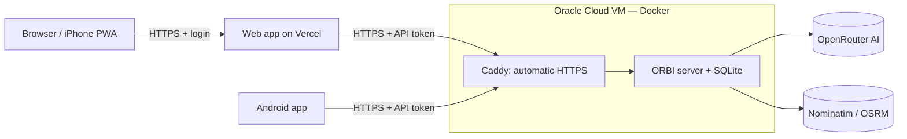

# Deploying ORBI (free tier)

This guide puts the **ORBI server** on a free cloud VM and the **web app** on Vercel, with AI through OpenRouter (or Ollama on the VM). Everything here works without paying, but free tiers have limits and can change — see [technical decisions §3](./technical-decisions.md#3-cost-classification-0-requirement).



Why this split: Vercel and Netlify only run short-lived functions and delete files between requests, so the server (which keeps a SQLite file) and Ollama cannot run there. Only the web app can.

## 1. Create the VM

Follow the Oracle Cloud steps (Ubuntu 24.04 aarch64, shape VM.Standard.A1.Flex, ingress rules for TCP 80 and 443) from [Oracle's guide](https://docs.oracle.com/iaas/Content/Compute/Tasks/launchinginstance.htm). Then connect:

```bash
ssh -i path/to/key.key ubuntu@<public-ip>
```

## 2. Prepare the VM

```bash
# Docker (official convenience script), then allow your user to run it
curl -fsSL https://get.docker.com | sudo sh
sudo usermod -aG docker ubuntu && newgrp docker

# Oracle's Ubuntu image blocks ports with its own firewall: open 80 and 443
sudo iptables -I INPUT 6 -m state --state NEW -p tcp --dport 80 -j ACCEPT
sudo iptables -I INPUT 6 -m state --state NEW -p tcp --dport 443 -j ACCEPT
sudo netfilter-persistent save
```

## 3. Get a domain name (free)

HTTPS certificates need a hostname. At [duckdns.org](https://www.duckdns.org/) sign in, create a subdomain (e.g. `orbi-yourname`) and set its IP to the VM's public IP. Your API will live at `https://orbi-yourname.duckdns.org`.

## 4. Start the server

```bash
git clone https://github.com/<you>/orbi.git && cd orbi
cp infra/.env.example infra/.env
nano infra/.env
```

Fill in:

| Variable                                          | Value                                                           |
| ------------------------------------------------- | --------------------------------------------------------------- |
| `ORBI_DOMAIN`                                     | `orbi-yourname.duckdns.org`                                     |
| `ORBI_API_TOKEN`                                  | output of `openssl rand -hex 24` (keep it; Vercel needs it too) |
| `AI_PROVIDER` / `AI_MODEL` / `OPENROUTER_API_KEY` | e.g. `openrouter`, a model ID ending in `:free`, your key       |
| `GEO_CONTACT_EMAIL`                               | your email (requested by the Nominatim usage policy)            |

Then:

```bash
docker compose -f infra/docker-compose.yml up -d --build
curl https://orbi-yourname.duckdns.org/health     # {"status":"ok",...}
```

Caddy fetches the certificate on first start (takes up to a minute). Logs: `docker compose -f infra/docker-compose.yml logs -f`.

**OpenRouter safety:** in the OpenRouter dashboard, set a credit limit on the key and only use `:free` models if you want to stay at $0. Free models allow about 50 requests/day.

**Ollama instead of OpenRouter:** start with `--profile ollama`, set `AI_PROVIDER=ollama`, `OLLAMA_BASE_URL=http://ollama:11434`, `AI_MODEL=<model>`, then `docker compose -f infra/docker-compose.yml exec ollama ollama pull <model>`. On the free ARM VM (2 cores, no GPU) expect drafts to take minutes.

## 5. Deploy the web app to Vercel

1. In Vercel, **Add New → Project** and import the repository.
2. **Root Directory:** `apps/web` (framework: Next.js; Vercel installs the pnpm workspace from the repository root).
3. **Environment variables:**

   | Variable            | Value                                                                                 |
   | ------------------- | ------------------------------------------------------------------------------------- |
   | `ORBI_API_URL`      | `https://orbi-yourname.duckdns.org`                                                   |
   | `ORBI_API_TOKEN`    | the same token as on the server                                                       |
   | `ORBI_WEB_PASSWORD` | a strong password — **required**: without it the web app refuses to forward the token |

4. Deploy, open the URL, log in. On iPhone: Safari → Share → **Add to Home Screen**.

Vercel's Hobby plan is free for personal, non-commercial use.

## 6. Android app

In `apps/mobile/.env`:

```bash
EXPO_PUBLIC_API_URL=https://orbi-yourname.duckdns.org
EXPO_PUBLIC_API_TOKEN=<the API token>
```

The token is built into the APK — keep the APK on your own devices, and rotate `ORBI_API_TOKEN` if it is ever shared.

## Backups and updates

```bash
# Backup: stop the server briefly so the SQLite files are consistent, copy them out, restart
docker compose -f infra/docker-compose.yml stop server
docker compose -f infra/docker-compose.yml cp server:/data ./orbi-backup-$(date +%F)
docker compose -f infra/docker-compose.yml start server

# Update to the latest code (the server migrates the database and backs it up first)
git pull && docker compose -f infra/docker-compose.yml up -d --build
```

Individual trips can also be exported from the API (`GET /trips/:id/export`) and re-imported (`POST /trips/import`).

## Self-hosting maps, search and routing (optional)

The defaults use free public services with fair-use limits (OpenFreeMap tiles, public Nominatim, the FOSSGIS OSRM demo). To remove that dependency, point the server at your own instances via `MAP_STYLE_URL`, `GEOCODER_BASE_URL` / `PHOTON_BASE_URL` and `ROUTER_DRIVING_URL` / `ROUTER_WALKING_URL` (set `GEO_MIN_INTERVAL_MS=0` for your own instances). Official images: [osrm-backend](https://github.com/Project-OSRM/osrm-backend), [Nominatim (mediagis)](https://github.com/mediagis/nominatim-docker), [Photon](https://github.com/komoot/photon), [OpenFreeMap](https://github.com/hyperknot/openfreemap). A Philippines extract from [Geofabrik](https://download.geofabrik.de/asia/philippines.html) is small enough for the free VM's disk, but OSRM and Nominatim preprocessing need several GB of RAM — check each project's requirements first.
