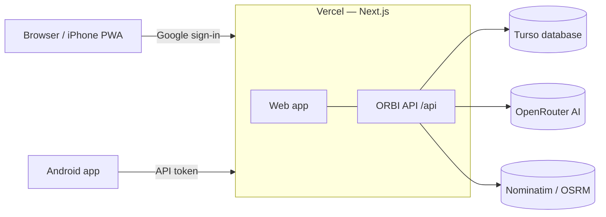

# Deploying ORBI

The recommended setup runs **everything on Vercel**: the web app and the API (served by Next.js at `/api`), with data in **Turso** and sign-in through **Google**. AI uses each user's own API key. No server to maintain.



All of these have free plans with limits that can change: [Vercel Hobby](https://vercel.com/docs/plans/hobby) is for personal, non-commercial use; check [Turso pricing](https://turso.tech/pricing) before relying on it.

## 1. Create the Turso database

With the [Turso CLI](https://docs.turso.tech/cli/installation) (or the dashboard):

```bash
turso db create orbi
turso db show orbi --url           # libsql://orbi-<you>.turso.io
turso db tokens create orbi        # auth token
```

Create the tables from your computer (run again after each update that adds migrations):

```bash
ORBI_DATABASE_URL=libsql://orbi-<you>.turso.io ORBI_DATABASE_AUTH_TOKEN=<token> pnpm --filter @orbi/db db:migrate
```

On Windows PowerShell, set the variables first: `$env:ORBI_DATABASE_URL="..."; $env:ORBI_DATABASE_AUTH_TOKEN="..."`.

Optional demo trip: run `pnpm --filter @orbi/server db:seed` with the same two variables.

## 2. Create the Google sign-in client

1. [Google Cloud Console](https://console.cloud.google.com/) → create a project → **APIs & Services → OAuth consent screen**: user type _External_, app name _ORBI_, add your email as a **test user** (testing mode is enough for personal use).
2. **Credentials → Create credentials → OAuth client ID** → _Web application_.
3. **Authorized redirect URIs:**
   - `https://<your-vercel-domain>/auth/google/callback`
   - `http://localhost:3000/auth/google/callback` (local development)
4. Copy the client ID and client secret.

ORBI only asks Google for your email address. Anyone with a Google account can sign in and sees only their own trips.

## 3. Deploy to Vercel

1. **Add New → Project**, import the repository.
2. **Root Directory:** `apps/web` (framework Next.js; Vercel installs the pnpm workspace from the repository root).
3. **Environment variables:**

   | Variable                                    | Value                                                      |
   | ------------------------------------------- | ---------------------------------------------------------- |
   | `ORBI_DATABASE_URL`                         | `libsql://orbi-<you>.turso.io`                             |
   | `ORBI_DATABASE_AUTH_TOKEN`                  | the Turso token                                            |
   | `GOOGLE_CLIENT_ID` / `GOOGLE_CLIENT_SECRET` | from step 2                                                |
   | `ORBI_API_TOKEN`                            | output of `openssl rand -hex 24` — used by the Android app |
   | `GEO_CONTACT_EMAIL`                         | your email (requested by the Nominatim usage policy)       |

4. Deploy, open the site, **Log in → Continue with Google**. On iPhone: Safari → Share → **Add to Home Screen**.

Safety rails: on Vercel the API refuses to start with a local database file (Vercel's disk is temporary), and the app refuses to serve trips if Google sign-in is not configured.

### AI: bring your own key

After signing in, open **Settings** and choose a provider (OpenRouter, OpenAI, Anthropic or Google), a model ID and your API key. The key is saved only in your browser and sent with each AI request; the server never stores it. Enter it again on another device or browser. Usage is billed by the provider to your account: on OpenRouter, models ending in `:free` cost nothing, and a credit limit on the key prevents surprises.

## 4. Android app

In `apps/mobile/.env`:

```bash
EXPO_PUBLIC_API_URL=https://<your-vercel-domain>/api
EXPO_PUBLIC_API_TOKEN=<ORBI_API_TOKEN>
```

The token is built into the APK — keep the APK on your own devices and rotate `ORBI_API_TOKEN` if it is ever shared.

## Local development

`pnpm dev` runs the web app with the API inside it and a local database file at `apps/web/data/orbi.db`. Without the Google variables, sign-in is off on your computer. To use Turso or Google sign-in locally, put the same variables in `apps/web/.env.local`.

For the Android app on your LAN, run the standalone server too: `pnpm --filter @orbi/server dev` (set `ORBI_HOST=0.0.0.0` and `ORBI_API_TOKEN` in `apps/server/.env`, and `ORBI_DATABASE_URL=file:../web/data/orbi.db` to share the web app's data).

## Notes and limits

- **Rate limits are per server instance.** Public Nominatim and OSRM allow about 1 request/second for your whole install. On Vercel several instances can run at once, so a burst from several devices could exceed that; results are cached in the database, which keeps repeat requests off those services.
- **Reordering long days is slower on Turso** than on a local file, because each position update is a network round trip (a day with 20 stops takes noticeably longer to save).
- **Backups:** Turso keeps point-in-time backups; individual trips can also be exported with `GET /api/trips/:id/export`.

## Alternative: your own server (VM + Docker)

To run the API on a VM instead (e.g. Oracle Cloud Always Free), use `apps/server` with `infra/docker-compose.yml` (Caddy provides HTTPS) and set `ORBI_API_URL=https://<vm-domain>` plus `ORBI_API_TOKEN` in the Vercel project: the web app then forwards `/api` to the VM. The server keeps its data in a local file (`ORBI_DATABASE_URL=file:/data/orbi.db`) or in Turso.

```bash
cp infra/.env.example infra/.env   # set ORBI_DOMAIN, ORBI_API_TOKEN, AI settings
docker compose -f infra/docker-compose.yml up -d --build
```

Oracle's Ubuntu image blocks ports 80/443 with its own firewall: open them with `sudo iptables -I INPUT 6 -m state --state NEW -p tcp --dport 80 -j ACCEPT` (and `443`), then `sudo netfilter-persistent save`. A free hostname for HTTPS: [DuckDNS](https://www.duckdns.org/).

Self-hosting maps, search and routing is optional: point `MAP_STYLE_URL`, `GEOCODER_BASE_URL`/`PHOTON_BASE_URL` and `ROUTER_DRIVING_URL`/`ROUTER_WALKING_URL` at your own [OpenFreeMap](https://github.com/hyperknot/openfreemap), [Nominatim](https://github.com/mediagis/nominatim-docker)/[Photon](https://github.com/komoot/photon) and [OSRM](https://github.com/Project-OSRM/osrm-backend) instances (`GEO_MIN_INTERVAL_MS=0` for your own).
