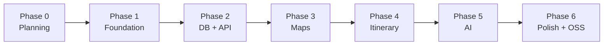

# ORBI — Implementation Roadmap

> Status: Draft for approval · Last updated: 2026-11-08
> Rule: one phase at a time. Each phase ends with its acceptance criteria demonstrated and the owner's approval before the next starts.
> “Verified” below means: the command was run and its output checked, or the behaviour was exercised in the running app.

Phases 3 and 4 overlap in practice (map and itinerary are one experience); they are split so each has a demonstrable end state. Web leads each phase; mobile follows within the same phase for the core flows.

---

## Phase 0 — Architecture & planning ✅ (this document set)

**Deliverables:** `docs/PRD.md`, `docs/architecture.md`, `docs/database.md`, `docs/roadmap.md`, `docs/technical-decisions.md`.

**Acceptance criteria**

- [x] Repository inspected; findings recorded (technical-decisions.md §0).
- [x] Stack compatibility evaluated with current versions; risks and costs classified.
- [x] Monorepo structure, DB schema, API boundaries, AI and geo abstractions defined.
- [x] Owner answered decisions 1–5 on 2026-11-08 (technical-decisions.md §5). Decision 6 (AI hardware, TD-21) is open but does not block Phases 1–4.
- [x] Owner approves the start of Phase 1.

---

## Phase 1 — Monorepo foundation

**Prerequisite (owner):** Node 26 LTS (or 24 LTS ≥ 24.3) installed and selected in the version manager; `pnpm -v` works.

**Tasks**

1. Clean-up: remove `.turbo-clone-temp` gitlink and directory, `apps/docs`, `packages/ui`; rename scope `@repo/*` → `@orbi/*`.
2. Pin Node (`.nvmrc` + `engines`), keep pnpm `packageManager`; extend `.gitignore` (`data/`, `*.db*`, `.env*` except `.env.example`, Expo/Android/iOS build dirs).
3. Create packages `core`, `geo`, `db`, `ai`, `api`, `theme` as empty JIT packages with `exports`, `tsconfig`, `check-types`, `lint`, `test` scripts; `apps/server` skeleton.
4. Replace `apps/web` demo with an ORBI shell: Tailwind v4, shadcn/ui init, Lucide, a placeholder planner layout.
5. Create `apps/mobile` with the current Expo SDK template (Expo Router, TypeScript), configured for the pnpm monorepo; produce an Android development build.
6. `turbo.json`: tasks `build`, `dev`, `lint`, `check-types`, `test`, `db:generate`, `db:migrate`; declare env vars (strict mode); `turbo boundaries` (undeclared-import check). `db:generate`/`db:migrate` move to Phase 2, where the database exists.
7. Shared ESLint config extended for Node and React Native (TD-02 approach); Prettier + Tailwind plugin; Vitest workspace config.
8. Open-source scaffolding: `LICENSE` (per TD-17), `README.md` (ORBI), `CONTRIBUTING.md`, `CODE_OF_CONDUCT.md` (Contributor Covenant), `.env.example`, `ATTRIBUTIONS.md` stub; dependency licence check script.
9. CI (GitHub Actions, free for public repos): install, lint, check-types, test.

**Acceptance criteria**

- [x] `pnpm install` succeeds from a clean clone on Windows (and is documented for macOS/Linux).
- [x] `pnpm dev` starts web (`:3000`) and server (`:3100`); `GET /health` returns 200; the web shell renders a value imported from `@orbi/core`.
- [ ] Android development build installs and launches on an emulator or device, renders a value from `@orbi/core`, and calls `/health` on the LAN server. **Blocked (2026-11-09):** the native C++ build fails because CMake 3.22.1's bundled ninja 1.10.2 cannot handle Windows paths over 260 characters; JS bundle verified with `expo export`. Needs a newer SDK CMake, a shorter repo path, or a newer ninja.
- [x] `pnpm lint`, `pnpm check-types`, `pnpm test` pass with zero warnings.
- [x] Importing `@orbi/db` from `apps/web` or `apps/mobile` fails the Boundaries check.
- [x] No secrets, DB files or `.env` files tracked (`git ls-files` reviewed).
- [x] Licence check lists no unknown/proprietary licences.

---

## Phase 2 — Database & backend

**Tasks**

1. Finalise driver/Drizzle version per TD-05 (verify Windows prebuilds); `createDb`, pragmas, migrations, backup-before-migrate.
2. Implement schema from `database.md` §4 (all tables, constraints, indexes) and generate the first migration.
3. Zod schemas and DTOs in `core`; repositories in `db`; services + routes in `api` for trips, preferences, days, destinations, items (CRUD, reorder, move), export/import.
4. Middleware: request ID, logging, problem+json errors, CORS allow-list, bearer token, body limit.
5. Typed client `@orbi/api/client`; TanStack Query wired in web and mobile (trip list + trip detail, read-only UI is enough).
6. Seed script (demo Cebu trip, fixture coordinates).

**Acceptance criteria**

- [x] Migrations apply to an empty DB and are idempotent on restart; generated SQL committed.
- [x] Integration tests (in-memory SQLite) cover every route: happy path, validation error (400 problem+json), not found (404), revision conflict (409).
- [x] Reorder and move keep positions contiguous and unique (property-style test with random sequences).
- [x] Deleting a trip removes all dependent rows; deleting a destination removes its items and re-packs positions (tested).
- [x] Changing trip dates adds/removes days correctly; removing a day with items requires confirmation flag.
- [x] Export → import round-trips a trip byte-for-byte equivalent (excluding IDs/timestamps).
- [x] Web and mobile list and open the seeded trip through the typed client (types flow end to end; a deliberate schema change produces a compile error in the apps).
- [x] Server refuses to start bound to `0.0.0.0` without `ORBI_API_TOKEN`.

---

## Phase 3 — Map experience

**Tasks**

1. `@orbi/geo`: interfaces, Nominatim + Photon geocoders, OSRM router, rate limiter, retry, User-Agent enforcement, polyline utils, nav links; recorded fixtures.
2. API: `/config`, `/places/search`, `/places/reverse`, `/days/:id/route` with `geocode_cache` and `route_leg_cache` (database.md §6).
3. Web map (`react-map-gl/maplibre`): style from `/config`, attribution, numbered markers as layers, per-day coloured route lines, dashed straight-line fallback, fit-to-day.
4. Mobile map (MapLibre RN v11): same features, same GeoJSON builders.
5. Destination search UI (submit-based Nominatim; optional Photon type-ahead) → add destination; drop-pin fallback (P1).
6. Route summary: per-leg and per-day distance/duration; driving/walking toggle per day.

**Acceptance criteria**

- [x] Searching “Magellan's Cross Cebu” returns candidates; adding one stores provider coordinates and `source_ref`; the same search repeated within TTL makes **zero** provider calls (verified by log/counter).
- [x] Provider calls never exceed 1 req/s under a burst of 10 searches (unit test on the limiter + manual log check).
- [ ] A day with 5 stops renders 5 numbered markers and road-following geometry on web and Android. _(Web verified in Edge with live OpenFreeMap tiles and OSRM geometry; Android code written and bundled, not yet run: native build blocked.)_
- [x] Reordering one stop triggers at most one provider request; unchanged legs come from cache.
- [ ] With routing disabled/unreachable, legs render dashed with a “straight line — not a road route” label and no duration; the app stays usable. _(Web verified by simulating an outage; server behaviour covered by tests.)_
- [ ] Switching `MAP_STYLE_URL` changes tiles in both apps without rebuilding the mobile app. _(Both apps read the style URL from `GET /config`; verified on web.)_
- [ ] OSM and tile attribution visible on both platforms. _(Web verified; Android uses MapLibre Native's attribution control, not yet seen on device.)_
- [x] Walking vs driving produce different durations for the same day.

---

## Phase 4 — Itinerary management

**Tasks**

1. `core.computeDaySchedule`, `summarizeDay/Trip`, warnings (I3), budget summary.
2. Web planner: split layout, day selector, timeline with arrival/departure/travel times, ideas list, `@dnd-kit` reorder within/between days (keyboard support), destination editor.
3. Mobile planner: map + three-snap bottom sheet, day selector, timeline, long-press reorder + Move up/down/to day actions, destination editor, “Open in maps”.
4. Bidirectional selection sync map ⇄ cards (both platforms).
5. Optimistic reorder with rollback on API error; route + schedule refresh after mutations.
6. Day optimisation proposal (`/days/:id/optimize`) — P1.

**Acceptance criteria**

- [x] Schedule unit tests: fixed times, overruns past day end, unknown travel legs, zero-item and one-item days.
- [x] Reordering on web by mouse **and** keyboard updates order, map numbering and route within 1 s on a cached route. _(verified 2026-11-09: keyboard reorder in Edge, persisted across reload with map and route updated; mouse drag uses the same handler but was not automated)_
- [ ] Moving an item between days on mobile via both long-press drag and the “Move to day” action. _(Move up/down/to-day actions implemented; long-press drag deferred; nothing run on a device yet (Android build blocked))_
- [ ] Tapping a marker scrolls to/highlights its card; tapping a card highlights and centres its marker (both platforms). _(web verified both directions; Android not run)_
- [ ] Failed reorder (server stopped) rolls back the UI and shows an error with retry. _(optimistic update with rollback and error message implemented on web, not exercised against a stopped server)_
- [x] Daily totals (travel time, visit time, estimated cost) match a hand-computed fixture trip. _(schedule and cost tests in packages/core)_
- [x] Empty, loading and error states exist for trip list, day timeline, ideas list and map. _(web)_
- [x] Axe (web) reports no serious/critical violations on the planner page. _(verified 2026-11-09: planner, stop editor and home page; fixed the muted-text contrast to pass)_

---

## Phase 5 — AI integration

**Tasks**

1. Spike: choose Ollama provider package (TD-10) and default model on the owner's hardware; build a 10-prompt eval set (schema validity, geocode hit rate, day balance, latency).
2. `@orbi/ai`: provider registry, prompts (versioned), preference extraction, generation pipeline, edit pipeline, validation + repair retry, tool definitions.
3. API: `/ai/drafts` (SSE progress, cancellation), `/trips/:id/ai/edits`, `/proposals/*` with `base_revision` staleness check.
4. Web + mobile: AI assistant panel, editable preference confirmation, proposal review on map/timeline (diff colouring), apply all/subset, discard.
5. Error handling: Ollama down, model missing, timeout, invalid output after retry — all with actionable messages.

**Acceptance criteria**

- [ ] The example prompt (“Plan a 3-day Cebu trip with a ₱10,000 budget… historical attractions, local food, and beaches”) yields a 3-day proposal where **every saved destination has provider-sourced coordinates**; unresolved places are flagged and cannot be applied until fixed/removed. _(draft pipeline verified end to end with a stand-in model and live Nominatim; not yet run with a real model (needs your key))_
- [x] No AI output schema contains coordinate fields (enforced by a test over the schemas).
- [x] Nothing is written to itinerary tables until the user applies a proposal (integration test).
- [ ] Edit prompts “Move the beach to day 2”, “Remove destinations that are too far apart”, “Add a restaurant near our hotel” produce operation lists (not regenerated itineraries) that pass validation on the seeded trip. _(operation mapping verified with a stand-in model; real-model behaviour untested)_
- [x] Applying a proposal after the trip changed returns 409 and the UI offers regeneration. _(API test; the web panel explains and offers discarding)_
- [x] With Ollama stopped: AI UI shows “AI unavailable” with setup help; all other features work. _(web shows 'AI assistant unavailable' with setup help; AI routes answer 503)_
- [ ] Eval set results recorded in `docs/ai-evals.md` (schema validity ≥ 90 % after repair retry on the chosen model — threshold to be confirmed after the spike). _(script ready: pnpm --filter @orbi/server ai:eval; results pending a run with your model)_
- [x] AI-estimated costs/hours/durations are visibly labelled as estimates.

---

## Phase 6 — Polish, testing, self-hosting, open-source readiness

**Tasks**

1. Responsive web (360 px → wide), PWA manifest for iPhone home-screen use, dark mode via tokens.
2. **Web read-only offline mode: done (2026-11-10, see technical-decisions §14).** Mobile read-only offline cache (persisted query cache) and connection status indicator; server URL/token settings screen.
3. Playwright E2E for the core journey with stubbed providers; mobile manual test checklist.
4. `docs/self-hosting.md`: Docker Compose profiles (server, Ollama, OSRM, Nominatim/Photon, PMTiles), regional extract scripts, Tailscale/Headscale guide, backups.
5. Final OSS pass: README quick-start verified on a clean machine, CONTRIBUTING (setup, conventions, DCO/CLA per TD-17), issue/PR templates, `ATTRIBUTIONS.md`, security policy.
6. Performance pass (bundle size on web, map layer counts, query invalidation).

**Acceptance criteria**

- [ ] A fresh clone → running app in < 30 min following only the README (excluding model/map downloads), verified on Windows and one other OS. _(not yet verified)_
- [ ] `docker compose --profile full up` runs ORBI with self-hosted routing/geocoding/tiles for a sample region with no external calls except the initial data download. _(scope changed: infra/docker-compose.yml runs server + HTTPS (+ optional Ollama) for the VM deployment; image steps verified without Docker (not installed here); self-hosted map services are documented, not composed)_
- [ ] E2E: create trip → add 3 destinations → reorder → route updates → AI draft (stubbed) → apply — green in CI. _(the same flow was run with Playwright locally; not yet a CI job)_
- [ ] Mobile shows the last-synced trip and routes in airplane mode. _(not implemented)_
- [ ] Owner completes the PRD success criteria (§8) on a real trip.

---

## Post-MVP backlog (not scheduled)

Offline map packs on mobile · iOS native app distribution · transit routing (other provider) · opening-hours verification from OSM tags · trip sharing (read-only link) · multi-user + Postgres · sync engine · additional AI providers (OpenAI-compatible) · expense tracking with actuals · calendar export (ICS) · photo/notes journal.
